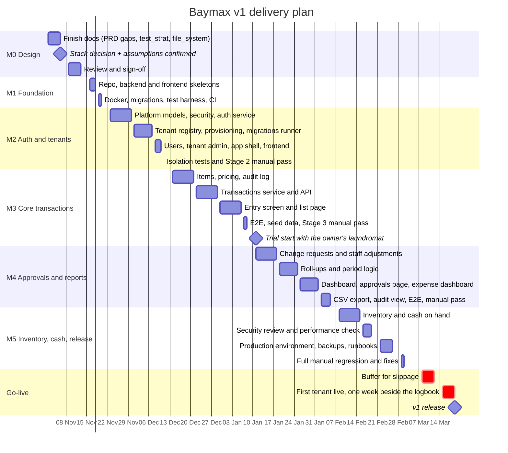

# Schedule (Gantt)

A plan for delivering Baymax v1, built from the milestones in `deliverables.md` and the objects in `object_masterlist.md`.

**This is an estimate, not a commitment.** No team size or weekly hours were specified, so the dates rest on the assumptions below. Change the assumptions first, then shift the dates.

## Assumptions

| # | Assumption | Effect if wrong |
|---|---|---|
| 1 | One developer working with Claude Code, roughly 15–20 focused hours a week alongside other work | Fewer hours stretch every phase proportionally |
| 2 | Start date is **Monday 2 Nov 2026** | Shift all dates by the same amount |
| 3 | The stack stays as the FastAPI baseline; the decision is made in week 1 | Switching to a Node API adds about 2 weeks to M1 and M2 |
| 4 | Each object gets a design doc approved before it is built (project workflow), which is included in the estimates | Skipping would shorten phases but break the workflow |
| 5 | The holiday period (24 Dec – 3 Jan) runs at half capacity | |
| 6 | A Windows machine on the same network is available for manual tests from M2 onward | Manual passes would block |
| 7 | The owner is available for short reviews (data-model assumptions, item lists, trial feedback) | Delays in M0 and M3 |

## Timeline

## Phase table

Working days exclude weekends. Phases are separated by short gaps for review and the manual test pass.

| Phase | Start | End | Working days | Depends on | Exit criteria |
|---|---|---|---|---|---|
| **M0** Design and decisions | 2 Nov 2026 | 13 Nov 2026 | 10 | | No open decision blocks M1; owner confirmed the six data-model assumptions |
| **M1** Foundation | 16 Nov 2026 | 20 Nov 2026 | 5 | M0 | One command starts the stack; CI green on an empty skeleton |
| **M2** Authentication and tenants | 23 Nov 2026 | 11 Dec 2026 | 15 | M1 | A SaaS Admin onboards a tenant; its users log in; isolation tests at 100% |
| **M3** Core transactions | 14 Dec 2026 | 8 Jan 2027 | 20 (reduced capacity 24 Dec – 3 Jan) | M2 | An employee records a day of sales and expenses on a phone; totals match by hand |
| *Trial start* | 11 Jan 2027 | | | M3 | Owner begins logging in parallel with the paper logbook |
| **M4** Approvals, reports, dashboard | 11 Jan 2027 | 5 Feb 2027 | 20 | M3 | Correction approved on a phone; dashboards and CSV agree |
| **M5** Inventory, cash, release prep | 8 Feb 2027 | 2 Mar 2027 | 17 | M4 | Production environment up; restore drill passed; security and performance checks done |
| Buffer | 8 Mar 2027 | 12 Mar 2027 | 5 | M5 | Absorbs slippage; unused buffer moves go-live earlier |
| **Go-live week** | 15 Mar 2027 | 19 Mar 2027 | 5 | Buffer | First tenant live a full week; totals match the logbook |

The days from 3 Mar to 5 Mar 2027 are left free for fixes found in the manual regression, and should be used before the buffer is touched.

## Milestones

| Date | Milestone |
|---|---|
| 13 Nov 2026 | Design complete, stack decided |
| 20 Nov 2026 | Skeleton and CI running |
| 11 Dec 2026 | Tenants and logins working, isolation proven |
| 8 Jan 2027 | **Core transactions done. Trial can start** |
| 5 Feb 2027 | Approvals, reports and dashboard done |
| 2 Mar 2027 | Feature complete and regression-tested |
| 19 Mar 2027 | **v1 release** (first tenant live and verified) |

## Critical path

`stack decision → foundation → auth → tenant registry and provisioning → items → transactions → change requests → roll-ups → dashboard → production environment → go-live week`

Anything on this path that slips moves the release date day for day. Work that can run alongside it:

| Work | Can run in parallel with |
|---|---|
| Email provider setup | M2 auth |
| Starter item lists and prices from the owner | M2 |
| Frontend scaffolding and pages | The matching backend routes, once `api_spec.md` is stable |
| CSV export | Dashboard work in M4 |
| Hosting selection and domain | M3 – M4 (needed by M5) |
| Rewriting `test_strat.md` | M1 |

## Risks to the schedule

| Risk | Likelihood | Effect | Mitigation |
|---|---|---|---|
| Stack decision drags | Medium | Delays M1 | Decide in week 1 of M0; default to FastAPI if undecided on 6 Nov |
| Tenant provisioning (create DB, role, migrations) is trickier than estimated | Medium | M2 +3–5 days | Build it before the user screens; test on a throwaway Postgres early |
| Holiday weeks slower than half capacity | High | M3 +1 week | Plan M3 so the entry screen (5.6) is the last item; items and the transaction API can be demoed first |
| Owner trial finds usability problems on the entry screen | Medium | Rework in M4 | Trial starts after M3 specifically to catch this early; reserve about 3 days in M4 |
| Roll-up period rules (week/half-year) produce edge-case bugs | Low | M4 +2 days | Unit tests on boundaries written before the service |
| Manual test machine unavailable | Low | Blocks the definition of done | Confirm access in M0 |
| Auth0 migration is pulled forward | Low | +1–2 weeks | Auth is behind an interface; keep it out of v1 scope |

## Tracking

- Update the status column in `object_masterlist.md` as each object is finished; use it to compare real progress against this plan weekly.
- When a phase finishes, record the actual dates here (add an "Actual" column) and re-forecast the rest.
- Daily notes and summaries follow the project workflow (`00_docs/stage*/`, `00_docs/summary/`, `00_docs/todos/`).

## After v1

Not scheduled yet. Candidates in `deliverables.md` § Later versions: Auth0 migration, PWA, `.xlsx` export, billing (v1.x); bookkeeping (v2); POS and cycle-count reconciliation (v3). Plan these after the first month of real use.
