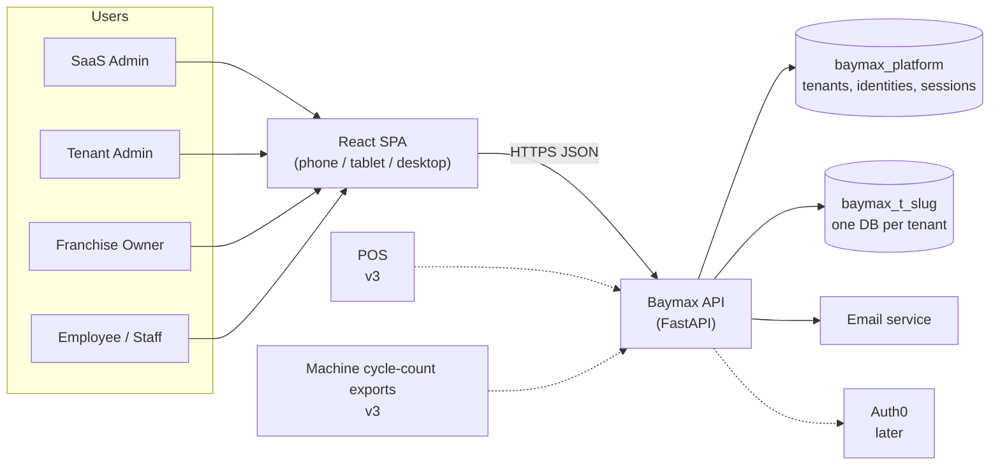

# Architecture Overview

A high-level view of how Baymax is put together. For the detailed mechanics see `system_design.md`; for tables see `data_model.md`; for endpoints see `api_spec.md`.

The tech stack is **not yet confirmed**. This document uses the baseline from `file_system.md` and `stack_comparison.md` (FastAPI, PostgreSQL, React). Where a choice is still open it is marked **[open]**.

## Table of Contents

1. [Goals that shape the design](#goals-that-shape-the-design)
2. [System context](#system-context)
3. [Components](#components)
4. [Multi-tenancy](#multi-tenancy)
5. [Authentication and authorization](#authentication-and-authorization)
6. [Request lifecycle](#request-lifecycle)
7. [Deployment](#deployment)
8. [Cross-cutting concerns](#cross-cutting-concerns)
9. [Evolution: v2 and v3](#evolution-v2-and-v3)
10. [Key decisions](#key-decisions)
11. [Open decisions](#open-decisions)

---

## Goals that shape the design

| Goal (from the PRD) | Architectural consequence |
|---|---|
| Deter staff pilferage | Records are append-only. Staff change nothing directly; every correction is a change request with an audit trail |
| Tenant data is separate | One database per tenant, plus one platform database. No query can cross tenants by accident |
| Auth in the DB now, Auth0 later | Authentication sits behind a small interface in one module; the identity table lives in the platform DB |
| Low-tech staff, phone/tablet/desktop | One responsive single-page app; big touch targets; entry is a few taps; no data entry that the server can compute |
| Real-time visibility for the owner | Roll-ups are computed from live data; no overnight batch needed |
| Small scale (target ~10 tenants, 5 users each) | A single backend process and a single Postgres server are enough. Prefer simple over scalable |
| Later: POS and machine cycle counts | Keep the transaction model source-agnostic, so POS and imports can write the same records |

---

## System context



Solid lines exist in v1. Dotted lines are planned.

---

## Components

| Component | Responsibility | Location |
|---|---|---|
| **Frontend SPA** | Login, transaction entry, item maintenance, approvals, dashboards, users, tenant admin. Talks to the API only | `frontend/` |
| **API layer** | HTTP routing, request/response validation, auth and role checks. No business logic | `backend/app/api/v1/` |
| **Services** | Business rules: pricing, totals, 5-user limit, change-request approval, roll-ups, provisioning | `backend/app/services/` |
| **Models / schemas** | SQLAlchemy models (split `platform/` and `tenant/`), Pydantic request/response types | `backend/app/models/`, `schemas/` |
| **Tenant DB registry** | Resolves a tenant slug to a cached connection pool for its database | `backend/app/tenant_db.py` |
| **Provisioner** | Creates a tenant database, runs its migrations, seeds the first Tenant Admin | `utils/db_provisioner.py`, `tenant_service.py` |
| **Platform database** | Tenant registry, login identities, sessions, reset tokens | `baymax_platform` |
| **Tenant databases** | Items, transactions, change requests, audit log, inventory, cash counts, settings | `baymax_t_{slug}` |
| **Migration tooling** | Alembic with two trees (platform, tenant); script to run tenant migrations on every tenant | `backend/alembic/`, `scripts/` |
| **Email** | Password reset and set-password links | external service **[open: Resend]** |

Layering rule: `api → services → models`. Routes never contain business logic, and services never touch HTTP objects. This keeps the services testable without a server.

---

## Multi-tenancy

```
                 ┌────────────────────────────┐
  login ───────► │  baymax_platform           │
                 │  user_identities (email →  │
                 │  tenant_id), tenants,      │
                 │  sessions                  │
                 └──────────────┬─────────────┘
                                │ session knows tenant slug
          ┌─────────────────────┼─────────────────────┐
          ▼                     ▼                     ▼
 ┌─────────────────┐   ┌─────────────────┐   ┌─────────────────┐
 │ baymax_t_alpha  │   │ baymax_t_beta   │   │ baymax_t_gamma  │
 └─────────────────┘   └─────────────────┘   └─────────────────┘
```

- **Isolation is physical.** Each tenant has its own database (and its own database role). There are no `tenant_id` columns in tenant tables to forget in a `WHERE` clause.
- **The tenant comes from the session.** A user's session points at one tenant. The API never accepts a tenant identifier from the client.
- **One code path to a tenant DB.** The only way to obtain a tenant session is the `get_tenant_db` dependency, which reads the tenant from the authenticated session. Tests assert that tenant A's session can't reach tenant B's data (100% coverage target, see `test_strat.md`).
- **SaaS Admin has no tenant** and can't read tenant data. It can create, suspend and inspect the status of tenants only.
- **Schema changes roll out to all tenants** by running the tenant migration tree against each tenant database (`scripts/migrate_all_tenants.py`). A tenant database records its schema version.

Trade-off accepted: database-per-tenant costs more connections and more operational steps (migrations, backups per tenant) than shared tables, in exchange for strong isolation and per-tenant backup/restore/export. At about 10 tenants this is cheap.

---

## Authentication and authorization

**Authentication (DB at launch).** Email and password against `user_identities` in the platform DB. Passwords are hashed with argon2id. A successful login creates a `sessions` row and sets an opaque token in an `HttpOnly` cookie; only the token's hash is stored.

**Designed for Auth0.** All of it lives behind a small interface in `auth_service.py`:

```
verify_credentials(email, password) -> Identity
issue_session(identity)            -> SessionToken
get_identity(request)              -> Identity       # used by get_current_user
revoke(identity | session)
```

To move to Auth0, a second implementation validates Auth0-issued JWTs in `get_identity`. `user_identities` keeps `tenant_id` (carried as a token claim or an Auth0 Organization), so tenant routing doesn't change, and tenant databases only know the stable identity UUID. Details in `data_model.md`.

**Authorization.** Roles live in each tenant DB (`users.role`: `tenant_admin`, `owner`, `staff`), with `saas_admin` held on the platform identity. `require_role(...)` is a route dependency; the access matrix is in `api_spec.md`. Role checks happen in the dependency *and* are asserted again in the service for the sensitive actions (setting prices, approving), so a new route can't skip them.

---

## Request lifecycle

Example: an employee records a sale.

```mermaid
sequenceDiagram
    participant UI as React SPA
    participant API as FastAPI
    participant P as Platform DB
    participant T as Tenant DB (baymax_t_x)

    UI->>API: POST /transactions (cookie, CSRF header)
    API->>P: look up session by token hash
    P-->>API: identity + tenant slug
    API->>API: require_role(staff|owner|tenant_admin)
    API->>T: get pooled connection for tenant
    API->>T: BEGIN; load items; price lines; insert transaction + lines + audit_log; COMMIT
    T-->>API: ok
    API-->>UI: 201 { id, total, status }
```

Entering a transaction is one database transaction in one database: header, lines and audit entry commit together or not at all.

---

## Deployment

```
        Internet
           │  HTTPS
   ┌───────▼────────┐
   │ CDN / DNS / TLS │   (e.g. Cloudflare)  [open]
   └───┬─────────┬──┘
       │         │ /api/*
 static│         ▼
 files │   ┌──────────────┐        ┌────────────────────────┐
       │   │ API container│──────► │ PostgreSQL 16          │
       ▼   │ (FastAPI,    │        │  baymax_platform       │
 ┌────────┐│ long-running)│        │  baymax_t_*  (N DBs)   │
 │ React  ││              │        └────────────────────────┘
 │ build  │└──────────────┘
 └────────┘
```

- The SPA is a static build served from a CDN or the same host.
- The API is a **long-running container**, not serverless, because it keeps a connection pool per tenant database.
- One PostgreSQL server hosts the platform DB and all tenant DBs at the start. Moving a heavy tenant to its own server later only changes that tenant's connection URL, which is stored in the registry.
- Local development is Docker Compose: Postgres, API, frontend. CI is GitHub Actions: lint, type check, pytest (real Postgres), Playwright.
- Hosting provider is **[open]** (see below).

Environments: `local`, `staging` (seeded with three test tenants), `production`.

---

## Cross-cutting concerns

| Concern | Approach |
|---|---|
| **Audit** | `audit_log` per tenant: who, what, before/after, request id. Append-only; the app's DB role can't update or delete it |
| **Security** | HTTPS only; argon2id; hashed session and reset tokens; CSRF header on mutating requests; login rate limiting and lockout; per-tenant DB role; generic errors with a request id; no tenant identifier accepted from the client |
| **Time** | Stored as UTC. Every tenant has a timezone, and records carry a `business_date` in that timezone, so "today's sales" means the laundromat's day |
| **Money** | `NUMERIC(12,2)`, decimal strings in JSON, rounding half-up in one place (the transaction service) |
| **Observability** | Structured JSON logs with tenant slug, user id and request id on every line; error tracking; health endpoint that checks the platform DB |
| **Backups** | Per-database `pg_dump` / point-in-time recovery. A tenant can be restored or exported alone |
| **Idempotency** | Transaction creation carries a client-generated id so retries on a flaky phone connection can't double-post |
| **Accessibility / UX** | Responsive layout; large touch targets for entry; language is plain ("Add wash", not "Create line item"); the entry screen needs no typing for fixed-price items |
| **Testing** | pytest against real Postgres (no mocks), Playwright E2E, tenant isolation tests at 100%. See `test_strat.md` (needs rewriting for Baymax) |

---

## Evolution: v2 and v3

The v1 design leaves room for these without rework:

| Version | Feature | How it fits |
|---|---|---|
| v1.x | Auth0 | Second implementation of the auth interface |
| v1.x | PWA (installable on the branch tablet) | Front-end packaging only |
| v2 | Full bookkeeping | Add a journal (chart of accounts, entries) to each tenant DB; posted transactions generate entries. Existing tables are unchanged |
| v3 | POS integration | A POS sends sales to a token-authenticated ingest endpoint that calls the same `transaction_service`; transactions record their `source` |
| v3 | Machine cycle counts | Import cycle-count exports (file upload first; direct feed later) into a `machine_cycle_counts` table; a reconciliation report compares cycles with wash/dry quantities sold per day. A background worker is introduced here if imports are heavy **[open]** |

---

## Key decisions

| # | Decision | Reason |
|---|---|---|
| 1 | Database per tenant (not schema per tenant) | Stronger isolation, per-tenant backup/restore, and the PRD asks for it |
| 2 | Separate platform DB for identities | Login must find the tenant before any tenant DB is known, and Auth0 migration touches only this database |
| 3 | Modular monolith (one API process) | One small team, ~10 tenants; microservices would add cost with no benefit |
| 4 | Append-only transactions + change requests | The core anti-pilferage control; gives the audit trail for free |
| 5 | Roll-ups computed on demand in SQL | Always current; avoids stale aggregates; fast at this data size |
| 6 | Money as `NUMERIC`, `business_date` in tenant time | Correct totals and correct "today" |
| 7 | Server decides prices for fixed items | A client can't tamper with a price |

---

## Open decisions

Carried over from `stack_comparison.md`, plus architecture-level ones:

1. Keep FastAPI or move to a Node.js API with a Python worker.
2. Auth0 or Clerk, and when to leave DB auth. (The PRD names Auth0.)
3. Background jobs in v1, or SQL-only roll-ups until v2/v3.
4. Hosting provider for the API and Postgres.
5. Email provider for reset and set-password links.
6. Whether the SaaS Admin needs a read-only support view of a tenant (currently: no).
