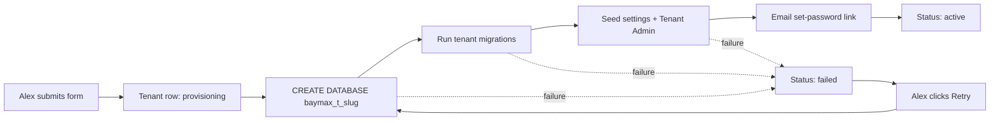
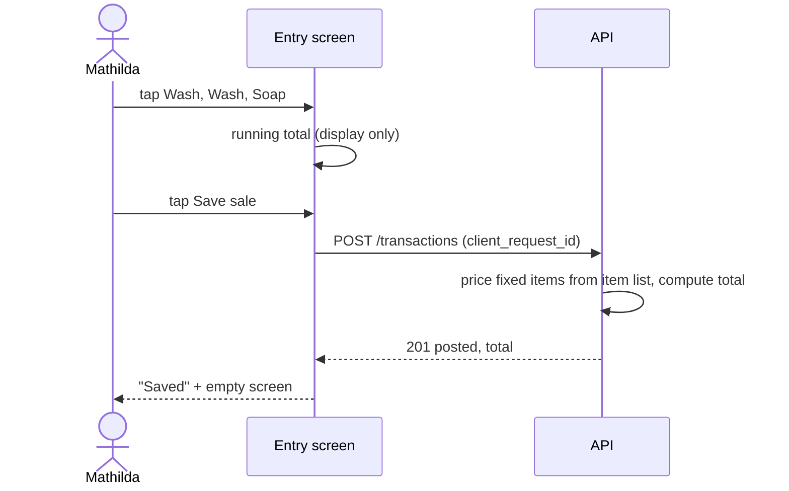

# Critical User Flows

The flows that must work for Baymax to be useful. Each one lists the persona, the trigger, the steps, what the system does, and what can go wrong. The personas are from `prod_req_doc.md`; endpoints are from `api_spec.md`.

Roles: **Alex** = SaaS Admin, **Iñigo** = Tenant Admin, **Lindsay** = Franchise Owner (`owner`), **Mathilda** = Employee (`staff`).

## Table of Contents

1. [Flow summary](#flow-summary)
2. [F1. Tenant onboarding](#f1-tenant-onboarding)
3. [F2. First login and set password](#f2-first-login-and-set-password)
4. [F3. Create users](#f3-create-users)
5. [F4. Set up item lists and prices](#f4-set-up-item-lists-and-prices)
6. [F5. Record a sale](#f5-record-a-sale)
7. [F6. Record an expense](#f6-record-an-expense)
8. [F7. Correct a mistake (change request)](#f7-correct-a-mistake-change-request)
9. [F8. File an adjustment](#f8-file-an-adjustment)
10. [F9. Owner approves](#f9-owner-approves)
11. [F10. End-of-day close](#f10-end-of-day-close)
12. [F11. Owner checks the business remotely](#f11-owner-checks-the-business-remotely)
13. [F12. Export for the accountant](#f12-export-for-the-accountant)
14. [F13. Forgot password](#f13-forgot-password)
15. [Cross-flow rules](#cross-flow-rules)
16. [Acceptance checks by flow](#acceptance-checks-by-flow)

---

## Flow summary

| # | Flow | Persona | Priority | Why it is critical |
|---|---|---|---|---|
| F1 | Tenant onboarding | Alex | Must | Nothing exists until a tenant does |
| F2 | First login and set password | Any new user | Must | Gate to everything |
| F3 | Create users | Iñigo | Must | Staff can't work without accounts; 5-user limit |
| F4 | Item lists and prices | Lindsay | Must | Entry screen is built from these |
| F5 | Record a sale | Mathilda | **Must, most frequent** | The core job. Must be fast |
| F6 | Record an expense | Mathilda / Lindsay | Must | Needed for net figures |
| F7 | Correct a mistake | Mathilda → Lindsay | Must | The anti-pilferage control |
| F8 | File an adjustment | Mathilda → Lindsay | Must | Same |
| F9 | Owner approves | Lindsay / Iñigo | Must | Closes the loop for F7 and F8 |
| F10 | End-of-day close | Mathilda | Must | Cash on hand vs recorded sales |
| F11 | Check the business remotely | Lindsay | Must | The owner's main reason to buy |
| F12 | Export for accountant | Lindsay | Should | Replaces the spreadsheet |
| F13 | Forgot password | Any | Must | Low-tech users forget passwords |

---

## F1. Tenant onboarding

**Persona:** Alex (SaaS Admin). **Trigger:** a new laundromat signs up.

1. Alex logs in and opens **Tenants**.
2. Alex chooses **New tenant** and enters business name, slug, timezone, currency, and the Tenant Admin's name and email.
3. System creates the tenant record (`provisioning`), creates the tenant database, runs the tenant migrations, creates the Tenant Admin identity and profile, and emails a set-password link.
4. The screen shows progress and then **Active**.

**Failure handling:** if any step fails the tenant becomes `failed` with a reason, and **Retry** re-runs provisioning safely (each step checks whether it already happened). A duplicate slug or email is rejected before anything is created.

**Done when:** the Tenant Admin can log in and sees an empty, working tenant.

---

## F2. First login and set password

**Persona:** any new user. **Trigger:** the set-password email.

1. User opens the emailed link, which carries a single-use token.
2. User picks a password (at least 10 characters) and submits.
3. System stores the hash, marks the token used, and sends the user to the login page.
4. User logs in with email and password. The system finds the user's tenant from their identity, creates a session, and opens the home screen for their role:
   - `staff` → Transaction entry
   - `owner` → Dashboard
   - `tenant_admin` → Users
   - `saas_admin` → Tenants

**Failure handling:** an expired or used link shows "This link has expired" with a button to request a new one. Wrong password shows one generic message; five failures lock the account for 15 minutes.

---

## F3. Create users

**Persona:** Iñigo (Tenant Admin).

1. Iñigo opens **Users**, sees "3 of 5 users" and chooses **Add user**.
2. Enters name, email, and role (`owner`, `staff`, or `tenant_admin`).
3. System creates the identity and profile, and emails a set-password link (F2).
4. To remove access, Iñigo deactivates the user. Their sessions end at once; their past records stay.

**Rules:** at most 5 active users per tenant. At the limit, **Add user** is disabled with the text "User limit reached. Deactivate someone or contact support." A tenant always keeps at least one active Tenant Admin. Users can't change their own role.

---

## F4. Set up item lists and prices

**Persona:** Lindsay (Owner). **Trigger:** first setup, or a price changes.

1. Lindsay opens **Items** and picks a list: **Sales**, **Expense** or **Adjustment**.
2. Adds an item: name, then **Fixed price** (enter the amount) or **Variable price** (no amount).
   - Starter sales items: Wash, Dry, Fold, Soap, Fabric conditioner
   - Starter expense items: Staff water, Staff ice, Staff snacks, Utility: electric, Utility: rent, Utility: water
3. Reorders items so the most used appear first on the entry screen.
4. To change a price, edits the item. The change applies to **new** transactions only; old ones keep their price. The change is logged.
5. To retire an item, switches it off (it disappears from entry, stays in history).

**Rule:** only the owner can create items or set prices. Staff and Tenant Admin see the lists read-only.

---

## F5. Record a sale

**Persona:** Mathilda (Employee), at the counter, with a customer waiting. **This is the flow to optimize.**

Target: a typical sale (a few items, fixed prices) in **under 15 seconds and with no typing**.

1. Mathilda opens the app; **Sales** entry is already the home screen. The date shows today.
2. She taps big item buttons: **Wash**, **Wash** (quantity becomes 2), **Soap**.
3. The running list shows each line, quantity, and the total, updating as she taps. She can tap **−** or **✕** on a line to fix a slip *before* saving.
4. For a **variable-price** item (e.g. Fold by weight), tapping it opens a number pad for the quantity and/or amount.
5. She taps **Save sale**. The app shows a short confirmation with the total ("Saved ₱208.00") and returns to an empty entry screen, ready for the next customer.

**What the system guarantees**
- Fixed prices come from the server's item list, not the screen, so they can't be altered.
- The record cannot be edited after saving. Mistakes go through F7.
- A double tap or retried request is saved once (idempotency key).
- The time of entry is set by the server.

**Failure handling:** on a lost connection the app keeps the sale on screen with "Not saved yet, retrying…" and retries with the same id; it doesn't clear the screen until the server confirms. If the day has already ended and the sale belongs to yesterday, staff can pick yesterday's date (up to 7 days back).

---

## F6. Record an expense

**Persona:** Mathilda or Lindsay.

Same screen pattern as F5, switched to **Expense** with its own item buttons (staff water, ice, snacks, utilities…). Fixed items add with a tap; variable items (e.g. an electricity bill) ask for the amount. A short note field is optional. Saved expenses are immutable like sales.

---

## F7. Correct a mistake (change request)

**Persona:** Mathilda (files), Lindsay (decides). **Trigger:** a saved record is wrong.

1. Mathilda opens **Transactions**, finds the record (filter by today and type), and taps **Request correction**.
2. She chooses **Cancel this transaction** or **Change it** (and edits the lines), and **must give a reason**.
3. The record shows a **Correction pending** badge. It still counts as originally entered until decided.
4. Lindsay is notified (badge on **Approvals**; email later). See F9.
5. On approval: the original is marked **voided** and, for a change, a corrected record is created next to it. Both stay visible. The reason, requester and approver are logged.
6. On rejection: the record stays as it was and Mathilda sees Lindsay's note.

**Rules:** one pending request per transaction. The requester can withdraw it while pending. Nobody can approve their own request.

---

## F8. File an adjustment

**Persona:** Mathilda. **Trigger:** something happened that isn't a single saved sale or expense, e.g. a refund, a short-change that was made up, a cash-in.

1. She opens **Adjustment**, picks whether it affects **Sales** or **Expenses**, whether it **adds or subtracts**, selects adjustment items and amounts, and gives a reason in the note.
2. She saves it. Status is **Pending approval**; it is **not** counted in totals yet.
3. Lindsay decides in F9.

If Lindsay or Iñigo records an adjustment, it posts immediately because they are the approvers.

---

## F9. Owner approves

**Persona:** Lindsay (Owner) or Iñigo (Tenant Admin).

1. **Approvals** shows a count of waiting items: change requests and staff adjustments, oldest first.
2. Each card shows who asked, when, the reason, and what changes (old total → new total).
3. Lindsay taps **Approve** or **Reject**. Reject requires a short note.
4. The result shows immediately in the transactions list and the roll-ups.

**Why it matters:** this is the control that deters pilferage. Everything an employee can't do directly ends up here, with a name and a time attached.

---

## F10. End-of-day close

**Persona:** Mathilda (or Lindsay).

1. At closing, Mathilda counts the cash and opens **Cash on hand**.
2. Enters the opening float and the counted amount.
3. The system shows **expected** (opening + the day's sales − expenses ± approved adjustments) and the **variance**.
4. She saves. A variance other than zero is flagged and visible to the owner.
5. Optionally she records supplies used or received in **Inventory** (e.g. "Detergent used: 1 bottle"). Items at or below their reorder level show a warning.

A count can't be edited; a wrong count is fixed by recording another one with a note.

---

## F11. Owner checks the business remotely

**Persona:** Lindsay, on her phone, away from the shop.

1. Opens the **Dashboard**. It shows today's sales, expenses and net, with the latest transactions.
2. Switches period: **Day / Week / Month / Half-year**, and moves back and forth in time.
3. Looks at the chart (sales vs expenses) and the by-item table.
4. Checks the **Expenses** dashboard for utilities, staff snacks, and so on.
5. Checks **Approvals** and **Cash on hand** variances.

Data is live: a sale saved at the counter appears on her dashboard on the next refresh (auto-refresh about every 30 seconds).

---

## F12. Export for the accountant

**Persona:** Lindsay.

1. In **Reports**, picks a date range (e.g. the month) and **Export CSV**.
2. A file downloads with one row per transaction line. It opens directly in Excel or Google Sheets.

This replaces transferring the logbook to a spreadsheet by hand.

---

## F13. Forgot password

1. On the login page the user taps **Forgot password** and enters their email.
2. The app always says "If that email is registered, we've sent a link", whether or not it exists.
3. The user follows the emailed link (valid 1 hour, single use) and sets a new password.
4. All their existing sessions are ended; they log in again.

---

## Cross-flow rules

| Rule | Where it applies |
|---|---|
| Staff can't edit or delete saved records | F5, F6, F7 |
| Every change is attributable: who, when, why | F4, F7, F8, F9 |
| Fixed prices are decided by the owner and enforced by the server | F4, F5 |
| Only approved items count in totals | F8, F9, F11 |
| A user only ever sees their own tenant | All |
| Deactivated users lose access immediately but keep their history | F3 |
| Entry screens need minimal typing and work on a phone, tablet or desktop | F5, F6, F10 |

---

## Acceptance checks by flow

Used to derive the E2E tests (`frontend/e2e/` in `file_system.md`).

| Flow | Check |
|---|---|
| F1 | Alex creates a tenant; it reaches `active`; its Tenant Admin can log in. A failed step shows `failed` and Retry completes it |
| F2 | A used or expired link is refused; a valid one sets the password and ends at the right home screen for the role |
| F3 | The sixth active user is refused; deactivating frees a slot; the last Tenant Admin can't be deactivated |
| F4 | Staff can't see edit controls; a price change doesn't alter an old transaction |
| F5 | Three taps + Save creates one posted transaction with the correct total; a repeated request creates no duplicate; a fixed price can't be overridden by editing the request |
| F6 | A variable expense asks for an amount; the total matches |
| F7 | Staff can't edit a saved record; a request without a reason is refused; approval voids the original and creates the replacement; the requester can't approve it |
| F8 | A staff adjustment is excluded from totals until approved; an owner adjustment posts at once |
| F9 | Rejecting without a note is refused; totals change only on approval |
| F10 | Variance equals counted minus expected; a second count for the same date and shift is refused |
| F11 | Totals per period match the underlying transactions; an entry made at the counter shows up on the owner's dashboard without a manual reload beyond the refresh interval |
| F12 | Exported rows and totals equal the on-screen figures for the range |
| F13 | An unknown email gets the same message as a known one; a reused link is refused; old sessions end |
| All | Tenant A's user can't read any tenant B data through UI or API |
