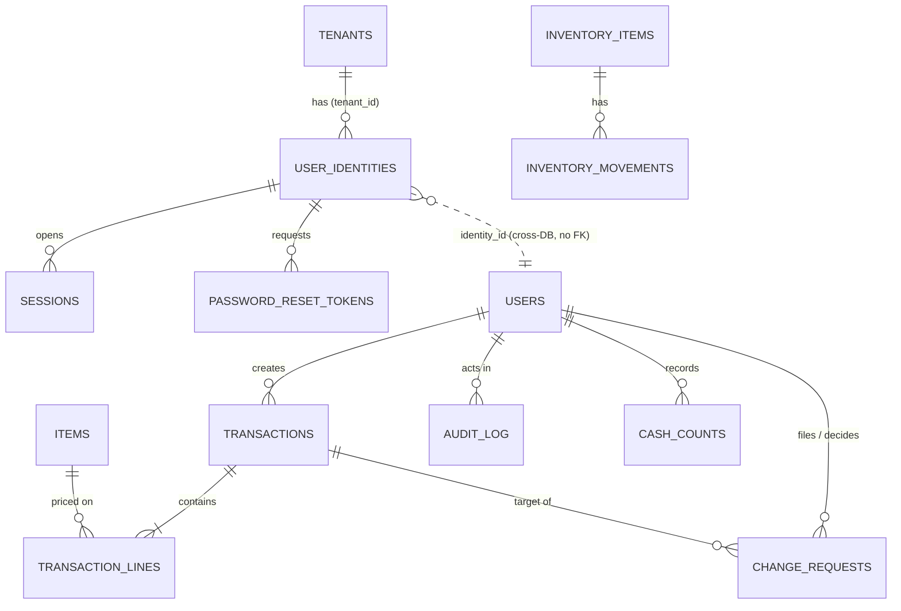

# Data Model

Baymax is multi-tenant with **database separation**. There are two kinds of database:

- `baymax_platform`: one shared database. Holds the tenant registry and authentication.
- `baymax_t_{slug}`: one database per tenant. Holds all laundromat data.

Table and column names match `file_system.md` (`backend/app/models/platform/` and `backend/app/models/tenant/`). All primary keys are `UUID` (generated by the app, `uuid7` where available so they sort by time). All timestamps are `timestamptz` stored in UTC. All money is `NUMERIC(12,2)`, never float.

## Table of Contents

1. [Conventions](#conventions)
2. [Platform database](#platform-database)
3. [Tenant database](#tenant-database)
4. [Entity relationships](#entity-relationships)
5. [Status lifecycles](#status-lifecycles)
6. [Roll-up definitions](#roll-up-definitions)
7. [Integrity rules](#integrity-rules)
8. [Auth0 migration notes](#auth0-migration-notes)
9. [Deferred to v2 / v3](#deferred-to-v2--v3)
10. [Assumptions to confirm](#assumptions-to-confirm)

---

## Conventions

| Topic | Rule |
|---|---|
| Keys | `id UUID PRIMARY KEY` on every table |
| Timestamps | `created_at`, `updated_at` (`timestamptz`, default `now()`); append-only tables have `created_at` only |
| Money | `NUMERIC(12,2)`. Currency is a tenant setting (`tenant_settings`), one currency per tenant |
| Business date | A `DATE` in the **tenant's timezone**. A transaction entered at 00:30 local time for the previous shift can be given the previous business date. Roll-ups group by `business_date`, never by `created_at` |
| Soft delete | Business records are never deleted. Items and users are deactivated (`is_active = false`). Transactions are voided through an approved change request |
| Cross-database references | Tenant tables never have foreign keys into the platform DB (separate databases can't). A tenant `users` row stores `identity_id`, a plain UUID matching `baymax_platform.user_identities.id`. The app guarantees it exists |
| Naming | `snake_case`, plural table names, `*_id` foreign keys |

---

## Platform database

### `tenants`

The registry. One row per laundromat customer.

| Column | Type | Notes |
|---|---|---|
| `id` | UUID PK | |
| `slug` | text, unique, not null | URL-safe, lower case, immutable once set. Drives the DB name |
| `name` | text, not null | Display name of the business |
| `db_name` | text, unique, not null | `baymax_t_{slug with - replaced by _}` |
| `status` | text, not null | `provisioning` \| `active` \| `suspended` \| `failed` |
| `timezone` | text, not null | IANA name, e.g. `Asia/Manila`. Copied into the tenant DB at provisioning |
| `user_limit` | int, not null, default 5 | Per the pricing rule (up to 5 users per tenant) |
| `created_at`, `updated_at` | timestamptz | |

### `user_identities`

One row per person who can log in. This is the table that moves to Auth0 later.

| Column | Type | Notes |
|---|---|---|
| `id` | UUID PK | |
| `tenant_id` | UUID FK → `tenants.id`, **nullable** | `NULL` means SaaS Admin (belongs to no tenant) |
| `email` | citext, unique, not null | Login name. Unique across the whole platform so login needs no tenant picker |
| `password_hash` | text, not null | argon2id |
| `is_saas_admin` | boolean, not null, default false | Must be true exactly when `tenant_id IS NULL` (CHECK constraint) |
| `is_active` | boolean, not null, default true | |
| `failed_login_count` | int, not null, default 0 | Reset on success |
| `locked_until` | timestamptz null | Temporary lockout |
| `last_login_at` | timestamptz null | |
| `created_at`, `updated_at` | timestamptz | |

Indexes: unique on `email`; index on `tenant_id`.

### `sessions`

| Column | Type | Notes |
|---|---|---|
| `id` | UUID PK | |
| `identity_id` | UUID FK → `user_identities.id` | |
| `token_hash` | text, unique, not null | SHA-256 of the opaque token. The raw token is never stored |
| `expires_at` | timestamptz, not null | |
| `last_seen_at` | timestamptz | Idle timeout is checked against this |
| `revoked_at` | timestamptz null | Set on logout or when a user is deactivated |
| `created_at` | timestamptz | |
| `user_agent`, `ip` | text null | For the owner's "who logged in" view |

### `password_reset_tokens`

| Column | Type | Notes |
|---|---|---|
| `id` | UUID PK | |
| `identity_id` | UUID FK → `user_identities.id` | |
| `token_hash` | text, unique, not null | |
| `expires_at` | timestamptz, not null | 1 hour |
| `used_at` | timestamptz null | Set on first use; a token with `used_at` set is dead (single use) |
| `created_at` | timestamptz | |

---

## Tenant database

Every tenant DB has the same schema, created by the Alembic `tenant` migration tree. Each DB also has a one-row `tenant_settings` table.

### `tenant_settings`

| Column | Type | Notes |
|---|---|---|
| `id` | smallint PK, CHECK `id = 1` | Single-row table |
| `business_name` | text | |
| `timezone` | text | Copied from `tenants.timezone` |
| `currency` | char(3) | ISO 4217, e.g. `PHP` |
| `week_starts_on` | smallint, default 1 | 1 = Monday. Used by weekly roll-ups |
| `schema_version` | text | Written by the migration runner, read by `migrate_all_tenants.py` |

### `users`

The tenant-side profile and **role** of a login identity.

| Column | Type | Notes |
|---|---|---|
| `id` | UUID PK | |
| `identity_id` | UUID, unique, not null | Matches `baymax_platform.user_identities.id` |
| `display_name` | text, not null | Shown in audit trails |
| `role` | text, not null | `tenant_admin` \| `owner` \| `staff` |
| `is_active` | boolean, not null, default true | |
| `created_at`, `updated_at` | timestamptz | |

The 5-user limit counts rows with `is_active = true`. SaaS Admins have no `users` row.

### `items`

The owner-maintained lists. One table, three lists, told apart by `category`.

| Column | Type | Notes |
|---|---|---|
| `id` | UUID PK | |
| `category` | text, not null | `sales` \| `expense` \| `adjustment` |
| `name` | text, not null | e.g. `Wash`, `Dry`, `Fold`, `Soap`, `Fabric conditioner`, `Staff water`, `Utility: electric` |
| `price_type` | text, not null | `fixed` \| `variable` |
| `price` | NUMERIC(12,2) null | Required when `price_type = 'fixed'`, must be `NULL` when `variable` (CHECK) |
| `sort_order` | int, not null, default 0 | Order of the big entry buttons |
| `is_active` | boolean, not null, default true | Inactive items vanish from the entry screen but stay on old transactions |
| `created_by` | UUID FK → `users.id` | |
| `created_at`, `updated_at` | timestamptz | |

Unique on `(category, lower(name))` among active rows.

Changing an item's `price` **never** changes past transactions, because each line copies the price it was sold at (see `transaction_lines.unit_price`). Every price change is written to `audit_log`.

### `transactions`

The header of one sale, expense or adjustment.

| Column | Type | Notes |
|---|---|---|
| `id` | UUID PK | |
| `type` | text, not null | `sales` \| `expense` \| `adjustment` |
| `adjusts_type` | text null | For `adjustment` only: `sales` or `expense`. Says which side of the books the adjustment moves |
| `adjusts_transaction_id` | UUID null FK → `transactions.id` | Optional link to the transaction being corrected |
| `business_date` | date, not null | |
| `status` | text, not null | See [lifecycles](#status-lifecycles) |
| `direction` | smallint, not null | `+1` or `-1`. Sign applied to the total in roll-ups. Sales `+1`, expense `+1` (reported on the expense side), adjustments may be `+1` or `-1` |
| `total` | NUMERIC(12,2), not null | Sum of line `amount`. Maintained by the service in the same DB transaction as the lines |
| `note` | text null | |
| `client_request_id` | UUID, unique, not null | Idempotency key sent by the UI. A double tap or a retried request can't create two records |
| `created_by` | UUID FK → `users.id`, not null | |
| `created_at` | timestamptz, not null | Server time, not editable |
| `decided_by` | UUID FK → `users.id` null | For adjustments: who approved or rejected |
| `decided_at` | timestamptz null | |

Indexes: `(business_date, type, status)`, `(created_by, created_at)`.

There is no `updated_at`. Once a transaction row leaves `pending`, its financial fields are immutable. The only column that changes afterwards is `status` (to `voided`).

### `transaction_lines`

| Column | Type | Notes |
|---|---|---|
| `id` | UUID PK | |
| `transaction_id` | UUID FK → `transactions.id`, not null | |
| `item_id` | UUID FK → `items.id`, not null | |
| `item_name` | text, not null | Copy of the name at the time of sale, for readable history |
| `quantity` | NUMERIC(10,2), not null, CHECK > 0 | Decimal so kilograms for fold-by-weight work |
| `unit_price` | NUMERIC(12,2), not null, CHECK >= 0 | For fixed items: copied from `items.price`. For variable items: entered by the user |
| `amount` | NUMERIC(12,2), not null | `quantity × unit_price`, rounded half-up to 2 places, computed by the service |
| `line_no` | int, not null | Order within the transaction |

Unique on `(transaction_id, line_no)`.

### `change_requests`

How staff ask for a correction. Staff never edit a posted record.

| Column | Type | Notes |
|---|---|---|
| `id` | UUID PK | |
| `transaction_id` | UUID FK → `transactions.id`, not null | The record to correct |
| `kind` | text, not null | `void` \| `correct` |
| `proposed` | JSONB null | For `correct`: the replacement lines and/or `business_date`. Null for `void` |
| `reason` | text, not null | Required. Staff must say why |
| `status` | text, not null | `pending` \| `approved` \| `rejected` \| `cancelled` |
| `requested_by` | UUID FK → `users.id`, not null | |
| `requested_at` | timestamptz, not null | |
| `decided_by` | UUID FK → `users.id` null | Must not equal `requested_by` (CHECK) |
| `decided_at` | timestamptz null | |
| `decision_note` | text null | Required when rejecting |

Approving a `void` sets the target transaction's `status = 'voided'`. Approving a `correct` voids the original and inserts a new transaction with the proposed lines, linked through `adjusts_transaction_id`. Both happen in one DB transaction together with the `audit_log` write.

### `audit_log`

Append-only. The application role has `INSERT` and `SELECT` on this table only, no `UPDATE` or `DELETE`.

| Column | Type | Notes |
|---|---|---|
| `id` | bigserial PK | Ordered, gap-tolerant |
| `at` | timestamptz, not null | |
| `actor_id` | UUID FK → `users.id`, not null | |
| `action` | text, not null | e.g. `transaction.create`, `item.price_change`, `change_request.approve`, `user.deactivate` |
| `entity` | text, not null | e.g. `transaction`, `item`, `change_request`, `user` |
| `entity_id` | UUID, not null | |
| `before` | JSONB null | |
| `after` | JSONB null | |
| `request_id` | text null | Correlates with API logs |

### `inventory_items`

Supplies the laundromat uses up (detergent, fabric conditioner, bags). These are separate from `items`, which are what is *priced* on a transaction.

| Column | Type | Notes |
|---|---|---|
| `id` | UUID PK | |
| `name` | text, not null | |
| `unit` | text, not null | e.g. `bottle`, `kg`, `pcs` |
| `reorder_level` | NUMERIC(10,2), not null, default 0 | Dashboard flags stock at or below this |
| `is_active` | boolean, not null, default true | |
| `created_at`, `updated_at` | timestamptz | |

### `inventory_movements`

Stock level is **derived**: `SUM(quantity)` per `inventory_item_id`. There is no stored balance to drift out of sync.

| Column | Type | Notes |
|---|---|---|
| `id` | UUID PK | |
| `inventory_item_id` | UUID FK → `inventory_items.id`, not null | |
| `kind` | text, not null | `stock_in` \| `used` \| `adjustment` |
| `quantity` | NUMERIC(10,2), not null | Signed: positive adds stock, negative removes it. `stock_in` must be > 0, `used` must be < 0 (CHECK) |
| `business_date` | date, not null | |
| `note` | text null | Required for `adjustment` |
| `created_by` | UUID FK → `users.id`, not null | |
| `created_at` | timestamptz, not null | |

### `cash_counts`

Cash on hand, counted at the end of a day or shift, compared with what the day's transactions say it should be.

| Column | Type | Notes |
|---|---|---|
| `id` | UUID PK | |
| `business_date` | date, not null | |
| `shift` | text, not null, default `day` | Free label, e.g. `am`, `pm`, `day` |
| `counted_amount` | NUMERIC(12,2), not null | What the person physically counted |
| `expected_amount` | NUMERIC(12,2), not null | Snapshot at count time: opening cash + posted sales − posted expenses ± approved adjustments for that date |
| `variance` | NUMERIC(12,2), not null | `counted_amount − expected_amount` |
| `opening_amount` | NUMERIC(12,2), not null, default 0 | Float carried in from the previous count |
| `note` | text null | |
| `created_by` | UUID FK → `users.id`, not null | |
| `created_at` | timestamptz, not null | |

Unique on `(business_date, shift)`. Cash counts are append-only. A wrong count is corrected by a new count, not an edit.

> **Assumption:** all sales are cash for v1. Card or e-wallet payments would need a `payment_method` on `transactions` (see [Assumptions to confirm](#assumptions-to-confirm)).

---

## Entity relationships



The dotted line between `USER_IDENTITIES` and `USERS` crosses the database boundary: it is a convention enforced by the app, not a foreign key.

---

## Status lifecycles

### Transaction

```
 staff/owner sales or expense ──────────────► posted ──(approved void)──► voided
 owner/tenant_admin adjustment ─────────────► posted ──(approved void)──► voided
 staff adjustment ──► pending ──approve──► posted
                          └───reject────► rejected   (terminal, excluded from roll-ups)
```

| Status | Counts in roll-ups | Meaning |
|---|---|---|
| `pending` | No | Staff adjustment waiting for the owner |
| `posted` | Yes | In the books |
| `rejected` | No | Owner declined a staff adjustment |
| `voided` | No | Cancelled by an approved change request; kept for the audit trail |

### Change request

`pending` → `approved` \| `rejected` \| `cancelled` (the requester withdraws it while still `pending`). All three outcomes are terminal.

---

## Roll-up definitions

Roll-ups are computed in SQL from `transactions` where `status = 'posted'`, grouped by `business_date`. Nothing is stored for v1.

| Period | Range | Notes |
|---|---|---|
| Daily | one `business_date` | |
| Weekly | `week_starts_on` to six days later | Default Monday–Sunday |
| Monthly | first to last day of the calendar month | |
| Half-year | Jan 1 – Jun 30, or Jul 1 – Dec 31 | Calendar halves. A fiscal-year option is a v2 setting |

For each period and each item the roll-up returns: quantity, sales total, expense total, adjustment total (split by `adjusts_type`), and **net = sales + sales-side adjustments − expenses − expense-side adjustments**.

---

## Integrity rules

Enforced in the database where possible, so a bug in a service can't break them:

1. `user_identities`: `is_saas_admin = (tenant_id IS NULL)` (CHECK).
2. `items`: `price_type = 'fixed'` ⇔ `price IS NOT NULL` (CHECK).
3. `transaction_lines`: `quantity > 0`, `unit_price >= 0` (CHECK).
4. `change_requests`: `decided_by <> requested_by` (CHECK). Nobody approves their own request.
5. `audit_log`: the app DB role has no `UPDATE` or `DELETE` grant.
6. `transactions.client_request_id` is unique, so retries are idempotent.
7. `inventory_movements`: sign of `quantity` matches `kind` (CHECK).

Enforced in the service layer (needs context across rows or databases):

- The 5-active-user limit (`user_service`), checked under a row lock on `tenant_settings` so two concurrent creates can't both pass.
- Only `owner` can create or change items and prices; only `owner` and `tenant_admin` can approve.
- `transactions.total` equals the sum of line `amount`.
- A fixed-price item's `unit_price` is taken from the server-side `items.price`, ignoring whatever the client sent.
- Cross-database consistency: a tenant `users.identity_id` exists in the platform DB (checked on user creation; a nightly job reports orphans).

---

## Auth0 migration notes

The migration is designed to touch one module (`auth_service.py`) and one table.

- `user_identities` is the only table that holds credentials. When Auth0 is adopted, `password_hash` becomes nullable and a nullable `external_subject` (`auth0|…`) column is added. Users are migrated in batches (Auth0 bulk import with the existing argon2 hashes, or lazy migration on first login).
- `tenant_id` stays in `user_identities`. With Auth0 it is carried as a custom claim, or by mapping an Auth0 **Organization** to each tenant.
- `sessions` and `password_reset_tokens` are used only by DB auth. They stay until cut-over is complete and then are dropped.
- Nothing in the tenant databases changes: they only know `users.identity_id`, and that UUID stays stable.

---

## Deferred to v2 / v3

| Version | Addition | Model impact |
|---|---|---|
| v2 | Full bookkeeping | `accounts` (chart of accounts), `journal_entries`, `journal_lines`; transactions post to the journal. Also fiscal-year setting, salary and capital-cost categories |
| v3 | POS integration | `pos_devices`; `transactions.source` (`manual` \| `pos`) and `external_ref` (unique per device) |
| v3 | Machine cycle counts | `machines`, `machine_cycle_counts` (machine, date, cycle count, imported batch id), and a reconciliation view comparing cycles to wash/dry sales lines per day |

Salary, capital-cost and operating-cost tracking are mentioned in the PRD summary. For v1 they are expense items in the `expense` list, not separate entities.

---

## Assumptions to confirm

1. **Adjustments by owner or tenant admin post immediately.** Only staff adjustments wait for approval.
2. **Variable prices are entered by any role at entry time.** The *item* is defined as variable by the owner only. (The PRD wording differs between the Owner and Employee personas; this is the reading that works for the staff persona.)
3. **All sales are cash.** No payment method column in v1.
4. **One currency and one timezone per tenant.**
5. **Corrections replace rather than edit.** An approved `correct` voids the original and inserts a new record.
6. **Quantity can be fractional** (for per-kilogram fold pricing).
